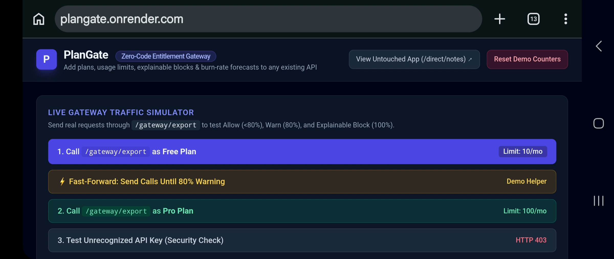

# PlanGate — Zero-Code API Entitlement Gateway

> **Add plans, usage limits, explainable blocks, and burn-rate forecasts to any existing API in minutes, with zero code changes.**

Built for **ADVANTIX HACKATHON 2026** (Department of AI & ML, Rajalakshmi Engineering College, in collaboration with Advantix AGI LLP & IEEE CIS).

---

## 📸 Dashboard Preview



*Live interactive dashboard with traffic simulator, Chart.js quota visualization, burn-rate forecast cards, and entitlement audit log.*

---

## 1. Problem & Solution

Modern entitlement and metering tools (Stigg, Orb, Metronome, Lago) expect engineering teams to weave SDKs and entitlement checks directly into application code while building a product from scratch.
- **Retrofitting existing or legacy APIs is painful** because it requires modifying and redeploying upstream services.
- **Opaque errors:** Blocked users receive a generic `429 Too Many Requests` or `403 Forbidden` with zero explanation of *why*, *when their quota resets*, or *which plan unblocks them*.
- **Zero early warning:** Customers hit hard walls unexpectedly without knowing their daily burn rate.

**PlanGate** solves this by acting as a drop-in reverse proxy gateway placed in front of any existing API:
1. **Zero-Code Retrofit:** Limits are defined per endpoint in config; the upstream microservice remains 100% untouched.
2. **Explainable Decisions:** Every warning (at 80%) and block (at 100%) returns structured reasons, UTC reset timestamps, standard quota headers (`X-PlanGate-*`), and the exact plan tier required to unblock traffic.
3. **Burn-Rate Forecast:** Calculates real-time daily usage velocity and predicts the exact date a customer will exhaust their quota.

---

## 2. Market Gap Comparison

| Feature / Capability | Legacy API Gateways (Kong / NGINX) | Code-Level Billing SDKs (Stigg / Orb / Lago) | **PlanGate (Ours)** |
| :--- | :---: | :---: | :---: |
| **Zero-Code Retrofit on Existing APIs** | ✅ Yes | ❌ No (Requires SDK integration) | **✅ Yes (Drop-in Proxy)** |
| **Per-Plan SaaS Entitlement Rules** | ❌ No (IP/Rate-based only) | ✅ Yes | **✅ Yes (Free, Pro, Custom)** |
| **Explainable Blocks (Why + Reset + Upgrade Tier)** | ❌ Plain HTTP 429 | ⚠️ Custom UI work required | **✅ Built-in JSON + Headers** |
| **Proactive 80% Quota Warnings** | ❌ No | ⚠️ Webhook setup required | **✅ Automatic Header & Payload Warning** |
| **Real-Time Burn-Rate Exhaustion Forecast** | ❌ No | ⚠️ Enterprise tiers only | **✅ Built-in `/forecast` Engine** |

---

## 3. Architecture

```text
+-------------------+       X-API-Key        +------------------------------------------------+
|   Client / App    | ----------------------> |          PlanGate Gateway (FastAPI)            |
+-------------------+                        |                                                |
         ^                                   |  1. SHA-256 Key Auth    2. Entitlement Engine  |
         |                                   |     & Input Validation     (<80% Allow,        |
         | Explainable JSON +                |                            >=80% Warn,         |
         | X-PlanGate-* Headers              |  3. Burn-Rate Forecast     100% Block)         |
         +---------------------------------- +----------------------+-------------------------+
                                                                    |
                                           +------------------------+------------------------+
                                           |                                                 |
                                           v (SQLite Persistence)                            v (httpx Proxy if Allowed)
                            +------------------------------+                  +------------------------------+
                            |      plangate.db (SQLite)    |                  |   Untouched Existing App     |
                            | - Hashed Customer Keys       |                  |   (Demo Notes & Export API)  |
                            | - Monthly Usage Counters     |                  |   Zero limit/plan code inside|
                            | - Explainable Audit Logs     |                  +------------------------------+
                            +------------------------------+
```

---

## 4. Quick Start

```bash
# 1. Clone the repository
git clone https://github.com/vijaykumar-001/plangate.git
cd plangate

# 2. Create and activate a virtual environment
python -m venv venv
# Windows:
venv\Scripts\activate
# Linux/Mac:
# source venv/bin/activate

# 3. Install dependencies
pip install -r requirements.txt

# 4. Start the gateway
uvicorn main:app --reload

# 5. Open the dashboard
# Visit http://localhost:8000 in your browser
```

### Demo API Keys

| Plan | API Key | Monthly Export Limit |
| :--- | :--- | :---: |
| Free | `pg_free_key_123` | 10 |
| Pro | `pg_pro_key_999` | 100 |

### Quick Test via cURL

```bash
# ALLOW — First call (within limits)
curl -H "X-API-Key: pg_free_key_123" http://localhost:8000/gateway/export

# BLOCK — Test invalid key (HTTP 403)
curl -H "X-API-Key: fake_key" http://localhost:8000/gateway/export

# FORECAST — Check burn-rate prediction
curl -H "X-API-Key: pg_free_key_123" http://localhost:8000/forecast?endpoint=/export

# RESET — Clear all counters for a fresh demo
curl -X POST http://localhost:8000/admin/reset
```

---

## 5. API Reference

| Method | Endpoint | Description |
| :--- | :--- | :--- |
| `GET` | `/` | Interactive Chart.js Dashboard with Live Traffic Simulator, Forecast Cards & Audit Log UI |
| `ANY` | `/gateway/{path}` | Zero-code entitlement proxy. Authenticates `X-API-Key`, enforces plan limits, injects `X-PlanGate-*` headers, and forwards allowed requests to the upstream API |
| `GET` | `/forecast?endpoint=/export` | Returns daily burn rate, remaining quota, and projected exhaustion date for the authenticated customer |
| `GET` | `/logs` | Returns real-time usage summary across plans and the latest 30 audit log entries |
| `POST` | `/admin/reset` | Resets demo counters and audit logs for live evaluation |
| `GET` | `/direct/notes` | Direct access to the untouched upstream Notes API (demonstrates zero limit logic inside the existing app) |
| `GET` | `/health` | Health check endpoint |

---

## 6. Security & Testing Highlights

- **SHA-256 API Key Hashing:** Raw API keys (`pg_free_key_123`, `pg_pro_key_999`) are never stored in plain text in SQLite; only SHA-256 digests (`api_key_hash`) are persisted and queried.

- **Server-Side Plan Enforcement:** Client requests cannot spoof plan names; plans are resolved strictly from the authenticated key hash.

- **Automated pytest Suite:** Verifies under-limit forwarding, 80% warning threshold, 100% HTTP 429 explainable block, invalid/missing key rejection, and burn-rate math.

### Run Tests

```bash
pytest test_plangate.py -v
```

---

## 7. Project Structure

```
plangate/
├── main.py              # FastAPI gateway: auth, routing, proxy, quota headers
├── engine.py            # Entitlement engine: ALLOW/WARN/BLOCK logic & burn-rate forecast
├── database.py          # SQLite: schema, hashed key auth, usage counters, audit logs
├── demo_app.py          # Untouched upstream Notes & Export API (zero entitlement code)
├── test_plangate.py     # pytest suite: 5 tests covering all entitlement scenarios
├── requirements.txt     # Python dependencies
├── static/
│   └── index.html       # Tailwind + Chart.js interactive dashboard
└── README.md
```

---

## 8. Future Scope

- **Distributed Redis Counters:** Sub-millisecond atomic counters across multi-region gateway nodes.

- **Multi-Tenant Self-Serve Portal:** Allow B2B SaaS admins to configure endpoints and pricing tiers dynamically via UI.

- **Webhook Alerts & Stripe Billing Sync:** Trigger Slack/email webhooks at 80% usage and one-click Stripe checkout links inside 429 responses.

- **Rate Limiting Per Second/Minute:** Add burst-rate protection in addition to monthly quotas.

- **Docker Support:** One-command deployment with `docker-compose up`.

---

## 9. License

This project is open source under the [MIT License](LICENSE).

---

**Built with ❤️ for the Advantix Hackathon 2026**
